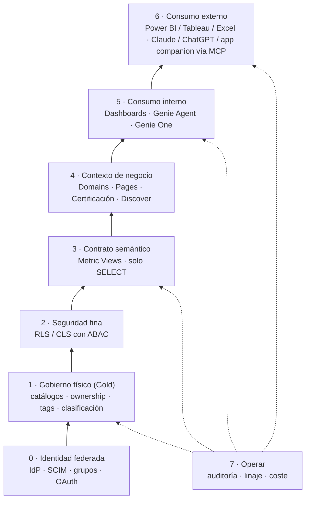

# Workshop: Gobierno de la Capa Semántica en Databricks
### De la tabla Gold al agente externo: gobernar una vez y exponer solo la semántica

> **v0.3 (19 nov 2026):** alineado con lo construido y desplegado (waves 0–8). Cambios: (1) numeración de pasos en **Tesis + 8 pasos**; el paso no estructurado sale del recorrido (ver nota en Paso 6); (2) el consumo externo (Paso 7) lo sirve la app companion `sgw-companion`, que actúa como cliente MCP externo con el OAuth de cada persona; (3) Operar se apoya en vistas `ops` sobre system tables; (4) tags gobernados con prefijo `sgw_` y cifras reales de referencia; (5) todo el despliegue usa APIs de workspace, nunca la consola de cuenta.
>
> **v0.2 (19 nov 2026):** se eliminó el paso de *conocimiento no estructurado* para mantener el workshop enfocado. El recorrido queda en **8 pasos**: Identity · Gold · RLS/CLS · Metrics · Context · Internal · External · Operate. Las secciones de abajo que mencionan volúmenes, AI Search o Knowledge Assistant quedan fuera de alcance.
>
> **Documento de diseño v0.3** · 19 nov 2026 · Autor: Lucas Romeo
> Base para: (1) presentación de 2 h · (2) artefactos versionados en GitHub y desplegables con Asset Bundles · (3) app wrapper para impartir el workshop

---

## 1. Por qué este workshop

### El problema, en una frase
> *Cada herramienta nueva (otro BI, otro agente, otro copiloto) crea su propia copia de la lógica de negocio y de las reglas de seguridad. Con la IA, el número de consumidores se multiplica y el problema crece con ellos.*

### Los 6 síntomas que la audiencia reconoce
| # | Síntoma | Consecuencia |
|---|---|---|
| 1 | **"Mismo KPI, números distintos"**: la lógica vive en Power BI, Tableau, cubos y vistas SQL duplicadas | Reconciliaciones manuales, desconfianza en el dato |
| 2 | **Conocimiento de negocio desconectado**: glosarios en herramientas externas que nadie usa, Confluence ad hoc | Cada analista o agente interpreta las métricas a su manera |
| 3 | **Gobierno = permisos**: se otorga SELECT, pero nadie sabe qué está certificado, quién es el dueño ni dónde buscar | Baja usabilidad; los activos existen pero no se encuentran |
| 4 | **Seguridad duplicada por herramienta**: RLS en el BI, otra vez en el cubo, otra vez en la app | Reglas inconsistentes y riesgo de fuga |
| 5 | **Agentes con acceso a tablas crudas**: el LLM ve columnas y filas que no debería y "inventa" cálculos (promedia porcentajes) | Riesgo de seguridad, respuestas incorrectas, coste |
| 6 | **Herramientas con cuentas de servicio**: BI y agentes conectados con una identidad compartida | Nadie sabe quién preguntó de verdad y las reglas se copian en cada herramienta |

### La tesis: la semántica se acerca, por gravedad, a donde viven los datos
- **Antes:** la semántica vivía en cada herramienta de BI (un modelo por herramienta).
- **Ahora:** los consumidores se multiplican (BI, apps, Genie, Claude, ChatGPT, agentes propios). Ya no es viable mantener un modelo por consumidor.
- **Conclusión:** la semántica (métricas, definiciones, dominios, certificaciones) y la seguridad (RLS/CLS) tienen que vivir **en el catálogo, junto al dato**, y servirse a todos los consumidores desde ahí.

### Principio rector del workshop
> **Gobierna una vez, abajo. Expón solo semántica, arriba.**
> Las tablas Gold se protegen físicamente (ownership, tags, RLS/CLS). Los usuarios finales **solo tienen `SELECT` sobre las Metric Views**. Todo consumidor, interno o externo, accede a través de esa capa semántica y hereda las mismas reglas, evaluadas con **la identidad de quien consulta**.

---

## 2. Mapa de capas (el "hilo" del workshop)

Avanzamos **de abajo hacia arriba, una capa por paso**. En la presentación, este mismo diagrama se repite en cada sección con la capa actual resaltada.



| Capa | Pregunta que responde | Quién es el dueño |
|---|---|---|
| 0 Identidad | ¿Quién eres y a qué grupo perteneces? | Plataforma / Seguridad |
| 1 Físico | ¿Dónde vive el dato, quién es su dueño y qué tan sensible es? | Data Engineering |
| 2 Seguridad fina | ¿Qué filas y columnas puedes ver? | Seguridad + Data Owner |
| 3 Semántica | ¿Qué significa cada KPI y cómo se calcula? (una sola vez) | Builder + Domain Owner |
| 4 Contexto | ¿Dónde lo encuentro, es oficial, quién responde por él? | Domain Owner / Steward |
| 5 Consumo interno | ¿Cómo lo uso dentro de Databricks? | Analistas / Negocio |
| 6 Consumo externo | ¿Cómo lo uso desde mis herramientas y agentes? | Negocio / IT |
| 7 Operar | ¿Quién accedió, qué cambió, cuánto cuesta? | Plataforma |

---

## 3. Recurso narrativo: una pregunta, de punta a punta

Para mantener el recorrido lineal, **toda la demo sigue la misma pregunta de negocio** y los **mismos tres personajes**:

> **❓ "¿Cuáles fueron las ventas netas por región en el último trimestre frente al presupuesto, y quiénes son los 5 mejores clientes?"**

| Persona | Grupo | Lo que debe ver |
|---|---|---|
| **Ana**, analista Iberia-ES | `wk_analysts_es` | Solo filas de España · PII de cliente (nombres, email, teléfono) **enmascarada** |
| **Pedro**, analista Iberia-PT | `wk_analysts_pt` | Solo filas de Portugal · PII **enmascarada** |
| **Marta**, responsable comercial global | `wk_sales_leads` + `wk_pii_readers` | Todas las regiones · PII visible |

**Momento clave (se repite en cada capa de consumo):** misma pregunta y misma definición de KPI, pero **resultados distintos según quién pregunta**, sin haber configurado seguridad en ninguna herramienta.

Roles de construcción (no consumen datos de negocio):

| Rol | Grupo | Responsabilidad |
|---|---|---|
| Admin de plataforma | `wk_platform_admins` | Identidad, previews, warehouses, Unity Gateway |
| Data engineer (builder) | `wk_data_engineers` | Dueño de Gold, crea Metric Views (YAML en Git) |
| Domain owner / steward | `wk_sales_domain_owners` | Certifica, gestiona el dominio y las Pages, aprueba accesos |
| Seguridad | `wk_security_admins` | Gestiona tags gobernados y políticas ABAC |

---

## 4. Dataset del workshop (genérico y reutilizable)

Dominio **Ventas retail**, sintético y generado con un job, de modo que se reproduce igual en cualquier workspace.

| Objeto | Tipo | Notas de gobierno |
|---|---|---|
| `gold.fact_sales` | Tabla | Grano: línea de ticket. Columna `store_region` → tag `sgw_region_scope` → RLS |
| `gold.fact_budget` | Tabla | Presupuesto mensual por región y categoría |
| `gold.dim_customer` | Tabla | `full_name`, `email`, `phone`, `tax_id` → tag `sgw_pii` → CLS |
| `gold.dim_store` | Tabla | Región, país, formato de tienda |
| `gold.dim_product` | Tabla | Categoría, marca |
| `gold.dim_date` | Tabla | Calendario fiscal |
| `semantic.v_sales_es_legacy` | Vista | Copia «BI» duplicada de ventas de ES; deprecada en el Paso 5 |

### Estructura de catálogo (segregación por propósito)
```
<catalog>                  ← parametrizable (p. ej. semantic_workshop)
 ├── gold        físico · sin acceso para consumidores
 ├── semantic    Metric Views · SELECT para consumidores
 ├── governance  UDFs de filtro y máscara · políticas ABAC · security admins
 └── ops         vistas sobre system tables para el paso Operar
```

---

## 5. Agenda (120 min)

| # | Bloque | Min | Formato | Acumulado |
|---|---|---|---|---|
| 0 | Apertura: el problema y la tesis | 10 | Slides | 0:10 |
| 1 | Principio rector y mapa de capas | 5 | Slides | 0:15 |
| 2 | **Paso 1** · Identidad federada | 8 | Slides + demo corta | 0:23 |
| 3 | **Paso 2** · Gobierno físico de Gold | 12 | Demo | 0:35 |
| 4 | **Paso 3** · RLS / CLS con ABAC | 15 | Demo | 0:50 |
| 5 | **Paso 4** · Metric Views como contrato semántico | 15 | Demo | 1:05 |
| 6 | **Paso 5** · Contexto de negocio y Discover | 15 | Demo | 1:20 |
| 7 | **Paso 6** · Consumo interno | 12 | Demo | 1:32 |
| 8 | **Paso 7** · Consumo externo (app companion como cliente MCP + BI) | 20 | Demo | 1:52 |
| 9 | **Paso 8** · Operar: auditoría, linaje, coste | 5 | Demo | 1:57 |
| 10 | Cierre: checklist de madurez y próximos pasos | 3 | Slides | 2:00 |

> Regla de ritmo: **cada paso sigue el mismo patrón** → *Problema (1 slide) → Concepto (1 slide) → Demo → "Qué cambió" (checkpoint)*. La audiencia siempre sabe en qué capa está y qué se agregó.

---

## 6. Paso a paso detallado

### Bloque 0 · Apertura: el problema y la tesis (10 min)
- **Objetivo:** que la audiencia reconozca su propio dolor antes de ver producto.
- **Contenido:**
  1. Los 6 síntomas (sección 1), con pregunta a la sala: *¿cuántos de estos tienen hoy?*
  2. La multiplicación de consumidores: ayer 1–2 BI; hoy BI + apps + Genie + Claude + ChatGPT + agentes propios.
  3. La tesis de la gravedad semántica: de "un modelo por herramienta" a "una semántica en el catálogo".
  4. "Gobierno ≠ permisos": las 7 dimensiones que cubriremos → **identidad, protección del dato, semántica, usabilidad/discovery, segregación de responsabilidades, operación y servicio a agentes**.
- **Mensaje clave:** *el problema no es la herramienta; es dónde vive la semántica.*

### Bloque 1 · Principio rector y mapa de capas (5 min)
- **Contenido:** "Gobierna una vez, abajo. Expón solo semántica, arriba." + el diagrama de capas + los 3 personajes y la pregunta de negocio.
- **Mensaje clave:** *vamos a construir esto capa por capa, y al final la misma pregunta funcionará igual en 8 herramientas distintas.*

---

### Paso 1 · Identidad federada (8 min) · Capa 0
- **Problema:** si cada herramienta gestiona sus propios usuarios, no hay forma de aplicar reglas consistentes ni de auditar quién hizo qué.
- **Conceptos:**
  - IdP corporativo (Entra ID / Okta) como **única fuente de identidad** → SSO + provisión SCIM o *automatic identity management*.
  - **Grupos a nivel de cuenta** como unidad de gobierno: nunca se otorgan permisos a usuarios individuales.
  - **Usuarios vs. service principals**: personas con OAuth U2M; procesos (pipelines, CI/CD) con SP y *workload identity federation* (sin secretos de larga duración).
  - Herramientas externas (Power BI, Claude, ChatGPT) → **OAuth por usuario**, de modo que cada consulta se ejecuta y se audita como esa persona.
- **Demo:**
  1. Workspace → *Identity and access* → grupos `wk_*` (identity proxy de la cuenta; sin consola de cuenta).
  2. Mostrar a Ana, Pedro y Marta y su pertenencia a grupos: son service principals de persona (`sgw-persona-*`, OAuth M2M) en los mismos grupos; los usuarios reales son opcionales.
  3. Mostrar el service principal de CI/CD `sgw-cicd` (la federación desde GitHub Actions es trabajo futuro, ver Paso 8).
- **Artefactos:** definición de grupos y SP (script de setup) · README con mapeo IdP → grupos.
- **Checkpoint:** *"Toda regla que veamos a partir de ahora se escribe contra grupos, y cada consulta lleva la identidad real del usuario."*

---

### Paso 2 · Gobierno físico de Gold (12 min) · Capa 1
- **Problema:** tablas sin dueño, sin clasificación y mezcladas con objetos de consumo; cualquiera con acceso al esquema ve todo.
- **Conceptos:**
  - **Segregación por propósito:** esquemas `gold` / `semantic` / `knowledge` / `ops` (y catálogos por entorno: dev / prod).
  - **Ownership a grupos, no a personas:** `gold` es propiedad de `wk_data_engineers`.
  - **Segregación de responsabilidades:** quien construye (`data_engineers`) ≠ quien define seguridad (`security_admins`) ≠ quien certifica (`domain_owners`) ≠ quien consume (`analysts`).
  - **Tags gobernados:** taxonomía pequeña y controlada (`sgw_sensitivity`, `sgw_pii`, `sgw_region_scope`; prefijo `sgw_`), donde solo grupos autorizados pueden asignar valores.
  - **Clasificación de datos:** detección automática de columnas sensibles → tags.
  - `BROWSE` vs. `SELECT`: poder *ver que existe* ≠ poder *leer el dato*.
- **Demo:**
  1. Catalog Explorer: estructura del catálogo y owners.
  2. Crear o mostrar los tags gobernados y sus valores permitidos.
  3. Asignar `sgw_pii` a `dim_customer.full_name/email/phone/tax_id` y `sgw_region_scope` a `fact_sales.store_region` (SQL `SET TAGS`; la clasificación automática sugiere revisiones).
  4. Mostrar que Ana **no tiene `USE SCHEMA` sobre `gold`**: no puede consultarlo.
- **Artefactos:** SQL de catálogo, esquemas, ownership y grants · definición de tags gobernados · asignación de tags.
- **Checkpoint:** *"El dato físico tiene dueño, está clasificado y está cerrado para los consumidores."*

---

### Paso 3 · Seguridad fina: RLS / CLS con ABAC (15 min) · Capa 2
- **Problema:** las reglas de "quién ve qué filas o columnas" se replican en cada herramienta, o directamente no existen.
- **Conceptos:**
  - **Row filters y column masks** definidos **una vez, sobre la tabla Gold**.
  - **ABAC:** políticas a nivel de catálogo o esquema que se aplican **automáticamente a toda tabla o columna con un tag** (p. ej. "toda columna `sgw_pii` se enmascara salvo para `wk_pii_readers`"). Escala mejor que asignar filtros tabla por tabla.
  - **Evaluación con la identidad de quien consulta**: incluso cuando la consulta llega a través de una vista, la política se evalúa contra el usuario final, no contra el dueño de la vista.
  - Requisitos: serverless o DBR 16.4+; en compute no soportado, la consulta **falla cerrada** (nunca devuelve datos sin filtrar).
- **Demo:**
  1. Crear la UDF de filtro por región (mapeo grupo → región) y la UDF de máscara de PII.
  2. Crear las dos políticas ABAC en el esquema `gold`: row filter sobre columnas con `sgw_region_scope` y column mask sobre columnas `sgw_pii`.
  3. **Momento clave #1:** Ana, Pedro y Marta ejecutan la misma consulta sobre `fact_sales` + `dim_customer`: Ana ve solo ES con nombres enmascarados, Pedro solo PT y Marta las cuatro regiones con nombres en claro.
  4. Etiquetar una tabla nueva con `sgw_pii` → queda protegida sin escribir nada más (*governance by tagging*).
- **Artefactos:** UDFs de filtro y máscara · políticas ABAC · tabla de mapeo grupo → región (opcional).
- **Checkpoint:** *"La seguridad fina vive en el dato, no en la herramienta. Cualquier tabla nueva que se etiquete queda protegida."*

---

### Paso 4 · Metric Views: el contrato semántico (15 min) · Capa 3
- **Problema:** cada BI o agente recalcula "ventas netas" a su manera; los agentes promedian porcentajes o suman métricas no aditivas.
- **Conceptos:**
  - **Metric View** = dimensiones + medidas + joins + filtros definidos **una vez** en YAML, como objeto de Unity Catalog. En `sales_metrics`: 11 dimensiones y **18 medidas** (atómicas, filtradas `FILTER (WHERE …)`, compuestas `MEASURE()`, de ventana y LOD).
  - **Metadatos semánticos para personas y agentes:** `comment`, `display_name`, `synonyms`, `format`.
  - Buenas prácticas: una fuente de hechos por Metric View, una Metric View por grupo de KPIs, nombres `<subject>_metrics` y comentarios en las 3 capas (vista, dimensión, medida).
  - **Medidas no aditivas** (ratios, %, distinct counts) se calculan en la Metric View y **nunca se re-agregan en la herramienta**.
  - **El patrón de exposición** (corazón del workshop):
    - Consumidores: `USE CATALOG` + `USE SCHEMA semantic` + **`SELECT` sobre las Metric Views**. Nada sobre `gold`.
    - La Metric View accede a Gold con los permisos de su **dueño**.
    - Las políticas RLS/CLS de Gold se siguen evaluando con la identidad de **quien consulta**.
  - **Metric Views como código:** YAML en Git, despliegue con Asset Bundles y PR review como control de cambios.
- **Demo:**
  1. Abrir `semantic.sales_metrics` (YAML): `net_sales`, `gross_margin_pct`, `net_sales_ly` (medida de ventana) y sinónimos en ES/PT/EN. `budget_attainment_pct` vive en `sales_vs_budget_metrics`.
  2. Consultar con `MEASURE()` agrupando por región.
  3. **Momento clave #2:** Ana y Pedro consultan la Metric View → **cada uno ve solo su región, con la misma definición de KPI**, y no tienen acceso a `gold`.
  4. Mostrar el linaje: Metric View → tablas Gold.
  5. Cifras de referencia (ventas netas 2026-Q3 por región, Metric View certificada): ES 10,97 M€ (35,3 %) · PT 7,77 M€ (25,0 %) · FR 7,08 M€ (22,8 %) · IT 5,23 M€ (16,8 %). Vista legacy frente a Metric View certificada, ES sep-2026: 3,87 M€ frente a 3,59 M€; la legacy sobreestima 273,45 K€ (+7,6 %) porque ignora los descuentos.
- **Artefactos:** `sales_metrics.yaml` y `sales_vs_budget_metrics.yaml` (sobre la vista base `gold.v_sales_budget_monthly`) · grants sobre `semantic` · job del bundle que despliega las Metric Views.
- **Checkpoint:** *"Una sola definición de KPI, con la seguridad heredada. Los consumidores solo ven semántica."*

---

### Paso 5 · Contexto de negocio y Discover (15 min) · Capa 4
- **Problema:** aunque el KPI esté bien definido, nadie lo encuentra, nadie sabe si es oficial y el glosario vive fuera de la plataforma.
- **Conceptos:**
  - **Domains y subdomains** en **Discover**: organización por área de negocio (`Retail Sales` › `Store Performance`, `Budget`), construida sobre tags gobernados, con contactos de negocio y técnicos.
  - **Pages:** el glosario gobernado (definición, sinónimos, owner, activos relacionados, fuentes). Es la fuente autoritativa para personas y para Genie One.
  - **Certificación / deprecación:** sello de "oficial". Solo el grupo `domain_owners` puede asignarlo (segregación de responsabilidades).
  - **Genie Code** genera borradores de Pages y comentarios a partir del código o YAML; el steward revisa y publica.
  - **Access Requests:** el usuario que encuentra un activo sin acceso lo solicita desde Discover y el dueño del dominio lo aprueba.
  - **Usabilidad:** curar secciones del dominio y fijar los activos clave.
- **Demo:**
  1. Crear y publicar el dominio `Retail Sales` con los subdominios `Store Performance` y `Budget`, y asignarle las Metric Views (`sales_metrics` y `sales_vs_budget_metrics`).
  2. Generar con Genie Code la Page *"Net Sales"* desde el YAML, revisarla, enlazarla a la Metric View y publicarla.
  3. Certificar las Metric Views (como domain owner) y deprecar `semantic.v_sales_es_legacy`.
  4. **Vista de negocio:** Ana entra a Discover → dominio Retail Sales → encuentra el KPI certificado, su Page y su dueño.
  5. Ana solicita acceso a un activo restringido → el domain owner aprueba.
- **Artefactos:** script de dominios (REST/Terraform, Beta) · Pages en Markdown, versionadas en Git y publicadas por API · script de certificación · *runbook* manual para las secciones de Discover (sin API).
- **Checkpoint:** *"La semántica no solo está bien definida: se encuentra, tiene dueño y se sabe que es oficial."*

---

### Nota · Conocimiento no estructurado (opcional, fuera de alcance)
- **Estado (19 nov 2026):** retirado del recorrido. En cuentas con la preview legacy *Serverless Access Controls* (`USAGE_POLICY_PREVIEW_ENABLED`), los Genie Agents no pueden adjuntar volúmenes, y no hay workaround a nivel de cuenta.
- **Si la preview se desactiva**, el bloque puede volver como paso opcional: volume con grants por grupo → `ai_parse_document` → índice de AI Search → Knowledge Assistant.
- **Principio que se mantiene:** las Pages dan la definición exacta (autoritativa); los documentos aportan contexto amplio (políticas, procedimientos).

---

### Paso 6 · Consumo interno: Dashboards, Genie Agent, Genie One (12 min) · Capa 5
- **Problema:** cada experiencia de consumo suele re-implementar lógica y seguridad.
- **Conceptos:**
  - **AI/BI Dashboards sobre Metric Views:** visualización sin reescribir KPIs y con credenciales del visor para que aplique la RLS.
  - **Genie Agent "Retail Sales"** (curado): las 2 Metric Views certificadas + instrucciones + SQL de ejemplo + 10 benchmarks. Es la experiencia acotada por dominio, con warehouse propio.
  - **Genie One:** punto de entrada único para negocio. Se apoya en **Genie Ontology** (Metric Views, Pages, dominios y certificaciones como conocimiento modelado) y solo usa el contexto de activos que el usuario puede ver. Las consultas se ejecutan **como el usuario**.
  - Genie prioriza los activos **certificados** y las **Pages** publicadas.
- **Demo:**
  1. Dashboard "Retail Sales Performance" sobre las Metric Views certificadas (credenciales del visor) → Ana vs. Marta.
  2. Genie Agent "Retail Sales" → la pregunta de negocio → mostrar el SQL generado (usa `MEASURE()` sobre la Metric View certificada).
  3. **Momento clave #3:** la misma pregunta en Genie One → cita la Page *Net Sales* y la Metric View certificada; Pedro ve solo Portugal.
- **Artefactos:** dashboard (JSON en el bundle) · Genie Agent (export/import) · benchmarks del Genie Agent.
- **Checkpoint:** *"Tres experiencias internas, cero lógica duplicada y cero seguridad duplicada."*

---

### Paso 7 · Consumo externo: BI y agentes de terceros (20 min) · Capa 6
- **Problema:** las herramientas externas (Power BI, Excel, Claude, ChatGPT, agentes propios) suelen conectarse con cuentas de servicio a tablas crudas, lo que rompe la semántica, la seguridad y la auditoría.
- **Conceptos:**
  - **Patrón de la app companion (demo de este paso):** la app corre dentro de Databricks Apps, pero hace de cliente externo: llama a los mismos endpoints públicos de Unity Gateway (`/ai-gateway/mcp-services/system.ai.genie_one_mcp` y `/ai-gateway/mcp-services/system.ai.dbsql`) con el **token OAuth de la persona** (on-behalf-of-user; scopes `sql`, `dashboards.genie`, `ai-gateway`). Claude, ChatGPT o cualquier cliente MCP hacen lo mismo tras iniciar sesión con OAuth de Databricks (SSO del IdP corporativo). Ningún cliente conoce las reglas: Unity Catalog evalúa grants, row filters y máscaras para esa persona y audita la llamada. El LLM del agente corre como service principal de la app y nunca lee datos; solo las llamadas MCP llegan a los datos, como la persona.
  - **BI externo sobre Metric Views:**
    - Power BI: JDBC/ODBC al SQL warehouse (DirectQuery con *native query*), o publicación como modelo semántico (Private Preview).
    - Tableau / Sigma: SQL con `MEASURE()` o **BI compatibility mode** (Databricks reescribe los `SUM`/`COUNT` generados por la herramienta aplicando la lógica de la medida).
    - Excel: conector de Databricks.
    - Genie Code puede **importar** modelos de Power BI/Tableau (`.pbit`, `.tmdl`, `.twb`…) y convertirlos en Metric Views. Sirve para migrar la semántica *desde* el BI *hacia* el catálogo.
  - **Agentes externos vía MCP**, en 3 niveles de abstracción:
    | Opción | Qué hace el agente externo | Cuándo |
    |---|---|---|
    | **Databricks SQL MCP** | Descubre Metric Views y escribe SQL | Máximo control y menor coste, sin capa LLM adicional |
    | **Genie Agent MCP** | Delega la pregunta a un Genie Agent curado (Genie como **subagente**) | Calidad acotada por dominio, warehouse por dominio |
    | **Genie One MCP** | Usa la ontología completa entre dominios | Descubrimiento amplio |
  - **Unity Gateway** como punto de control: grants sobre quién puede usar cada MCP, políticas por llamada y trazas.
  - **OAuth por usuario** de punta a punta: Claude Cowork o ChatGPT → MCP → consulta ejecutada como Ana, con RLS/CLS y auditoría.
  - **Restricción de acceso externo:** políticas de red / context-based ingress para limitar desde dónde se usan CLI y APIs.
- **Demo:**
  1. Power BI o Tableau conectado a `sales_metrics` → misma cifra que el dashboard.
  2. Claude Cowork / ChatGPT, o la app companion como cliente MCP, con Genie One MCP o DBSQL MCP → la pregunta de negocio como Ana. Trampa: pedir filas crudas de `gold.fact_sales` → Unity Catalog la rechaza (`INSUFFICIENT_PERMISSIONS`).
  3. **Momento clave #4 (cierre de la demo):** tabla comparativa en vivo con la **misma pregunta en 6 superficies** (SQL, Dashboard, Genie Agent, Genie One, BI externo, Claude) → **mismo número para el mismo usuario y la misma restricción por región.**
  4. *(Opcional)* agente propio que orquesta Genie como subagente vía MCP.
- **Artefactos:** configuración de Unity Gateway y MCP · guía de conexión de Claude/ChatGPT · archivo `.pbids`/`.tds` de ejemplo · agente orquestador de ejemplo (opcional).
- **Checkpoint:** *"El consumo externo hereda todo: semántica, seguridad y auditoría. Agregar una herramienta nueva no agrega trabajo de gobierno."*

---

### Paso 8 · Operar: auditoría, linaje y coste (5 min) · Capa 7
- **Problema:** sin observabilidad, el gobierno es una declaración y no un control.
- **Conceptos:**
  - **System tables:** `system.access.audit` (quién consultó qué, desde qué herramienta), linaje de tablas y columnas, historial de consultas y facturación (coste por consumidor o agente). Vistas en `ops`: `semantic_activity`, `blocked_attempts`, `lineage`, `workshop_cost`.
  - **Caveat:** las sentencias rechazadas en el análisis pueden quedar en `system.query.history` con `client_application = 'unknown'`, así que el feed puede etiquetar un intento MCP bloqueado como «SQL API».
  - **Control de cambios:** PR en GitHub → validación del bundle en CI (`bundle validate`). Las Metric Views, las Pages y las políticas se versionan. El despliegue continuo con service principal federado (sin secretos) es trabajo futuro: requiere una política de federación a nivel de cuenta, fuera del alcance del workshop.
  - **Ciclo de cambio:** cambio de KPI = PR → review del builder → el domain owner re-certifica.
- **Demo:**
  1. Dashboard «Governance in action» y consulta en `ops`: las consultas de Ana desde cada superficie (Genie, dashboard, app, MCP, SQL API), todas atribuidas a su identidad, incluidos los intentos bloqueados.
  2. Linaje de punta a punta: Gold → Metric View → Dashboard / Genie.
  3. Un PR que modifica una medida: CI lo valida y el despliegue lo ejecuta el builder con el bundle.
- **Artefactos:** vistas en `ops` · dashboard «Governance in action» · `.github/workflows/validate.yml`.
- **Checkpoint:** *"Todo es auditable, trazable y reproducible."*

---

### Bloque 10 · Cierre (3 min)
- **Checklist de madurez** (autoevaluación de la audiencia, del 0 al 3 por dimensión):

| Dimensión | Pregunta |
|---|---|
| Identidad | ¿Toda herramienta usa identidad federada y OAuth por usuario? |
| Protección | ¿RLS/CLS definidas una vez, sobre el dato, por tags? |
| Semántica | ¿Cada KPI tiene una única definición como código? |
| Exposición | ¿Los consumidores solo acceden a la capa semántica? |
| Discovery | ¿Los KPIs se encuentran por dominio, con dueño y certificación? |
| Agentes | ¿Los agentes externos consumen vía MCP con identidad del usuario? |
| Operación | ¿Auditoría, linaje y coste sobre todo lo anterior? |

- **Próximos pasos propuestos:** MVP de 2 semanas sobre un dominio usando este mismo repositorio.

---

## 7. Inventario de artefactos (insumo para el repositorio)

| Paso | Artefacto | Mecanismo de despliegue | Nivel de automatización |
|---|---|---|---|
| 0 | Generación de datos sintéticos | Job (bundle) | ✅ Automático |
| 1 | Grupos y service principals | Script (identity proxy del workspace; admin de workspace) | ⚠️ Semi: depende del IdP del cliente |
| 2 | Catálogo, esquemas, ownership, grants | SQL en job (bundle) | ✅ |
| 2 | Tags gobernados + asignación | Script SDK/SQL | ✅ |
| 3 | UDFs y políticas ABAC | SQL en job | ✅ |
| 4 | Metric Views (YAML) | SQL en job (bundle) | ✅ |
| 5 | Dominios | REST / Terraform (Beta) | ⚠️ Semi |
| 5 | Pages | REST API desde Markdown en Git | ✅ (feature Beta) |
| 5 | Certificaciones | SQL `SET TAG` | ✅ |
| 5 | Secciones de Discover | Manual (sin API) | ❌ Runbook |
| 6 | Dashboard | Bundle (`dashboards`) | ✅ |
| 6 | Genie Agent + benchmarks | Export/import vía API | ✅ |
| 7 | Unity Gateway / MCP | UI + guía; la app companion usa los endpoints | ❌ Runbook |
| 7 | Conexión Claude / ChatGPT / Power BI | Guía paso a paso | ❌ Runbook |
| 8 | Vistas `ops` + dashboard «Governance in action» | Bundle | ✅ |
| 8 | GitHub Actions | `.github/workflows` (validación en PR; CD futuro) | ⚠️ Semi |
| — | **App companion (`sgw-companion`)** | Databricks App (bundle) | ✅ |

### Estructura propuesta del repositorio

> Propuesta de la v0.1. La estructura real está en el README (`src/w2_gold` … `src/w7_operate`, `app/`, `resources/`, `scripts/`).
```
semantic-governance-workshop/
├── databricks.yml                 # bundle con variables: catalog, warehouse_id, grupos, prefijo
├── resources/                     # jobs, dashboards, app, pipelines
├── src/
│   ├── 00_data/                   # generación sintética + PDFs
│   ├── 01_identity/               # grupos y SPs (identity proxy del workspace)
│   ├── 02_physical/               # catálogo, esquemas, ownership, tags
│   ├── 03_security/               # UDFs + políticas ABAC
│   ├── 04_semantic/               # *.metric_view.yaml + deploy SQL
│   ├── 05_context/                # pages/*.md, domains, certificación
│   ├── 07_consumption/            # dashboard, Genie Agent, benchmarks
│   ├── 08_external/               # guías MCP, Power BI/Tableau, agente orquestador
│   └── 09_ops/                    # vistas sobre system tables
├── app/                           # app wrapper (navegación por pasos)
├── runbooks/                      # pasos manuales (Discover, Unity Gateway, conexiones externas)
├── docs/                          # este documento + guion del presentador
└── .github/workflows/deploy.yml
```

### App companion `sgw-companion` (wave 8, construida)
- Navegación lineal **Paso 0 → 8** con el mismo mapa de capas resaltado.
- Cada paso muestra: concepto, enlaces directos a los objetos reales (Catalog Explorer, dashboard, Genie, Discover, jobs), una prueba viva con la identidad elegida y los chips ✓ de su job de verificación.
- Panel **"Ver como…"** (Tú / Ana / Pedro / Marta) y, en el paso 7, un chat del agente sobre MCP con la traza OBO en vivo. Detalle en `docs/APP_DESIGN.md`.

---

## 8. Prerrequisitos para impartirlo

| Requisito | Detalle |
|---|---|
| Workspace con Unity Catalog | Serverless SQL warehouse y serverless compute |
| Admin de workspace (setup) | Grupos (identity proxy), tags gobernados, service principals. Sin consola de cuenta; las previews las habilita antes el admin de cuenta |
| Previews habilitadas | Pages (Beta), Domains (Public Preview), Managed MCP Servers, Enhanced Unity Gateway (para DBSQL MCP, Beta) |
| Usuarios de prueba | 3 identidades (Ana / Pedro / Marta): service principals de persona (por defecto) o usuarios reales en los mismos grupos, con perfiles de navegador separados |
| Herramientas externas | Claude Cowork y/o ChatGPT con conectores MCP · Power BI Desktop o Tableau (opcional) |
| GitHub | Repo con validación del bundle en PR · CD con *workload identity federation*: trabajo futuro |

---

## 9. Estado de features y puntos a validar en la fase de construcción

| Feature | Estado conocido (nov 2026) | A validar |
|---|---|---|
| Metric Views | En uso (Relationships en Beta) | Comportamiento de RLS/CLS de Gold al consultar vía Metric View (esperado: evaluación con quien consulta, como en vistas) · restricciones de materialización con políticas |
| ABAC | Disponible; políticas a nivel metastore, sobre vistas y DENY en Beta | Requisitos de compute en el workspace del cliente |
| Domains / Discover | Public Preview | Sin API para secciones de Discover · validación del tag para subdominios |
| Pages | Beta · se replica globalmente, sin CMK | Residencia de datos del cliente · versionado (solo audit log) |
| Certificación | Disponible (tag de sistema) | Sin workflow de aprobación nativo → PR + permiso ASSIGN |
| Access Requests | Mencionado en producto | Estado y flujo exactos |
| Genie One MCP | GA | Conexión desde Claude Cowork / ChatGPT (la app companion ya lo usa, con OAuth por usuario) |
| DBSQL MCP (`system.ai.dbsql`) | Beta | Selección de warehouse desde clientes externos (la app pasa `_meta.warehouse_id`) |
| OBO → Unity Gateway MCP | Validado (spike 8a) | Requiere el scope de usuario `ai-gateway`; los usuarios lo consienten una vez |
| Genie Agent MCP | Public Preview | — |
| Power BI semantic model desde Metric View | Private Preview | Alternativa: DirectQuery con native query |
| BI compatibility mode | Disponible | Escenarios soportados y limitaciones |
| Promoción Genie | Uso gratis para usuarios nominales hasta 31 ene 2027 (no SPs) | Mensaje de coste para el cliente (los service principals de persona sí facturan) |

---

## 10. Decisiones abiertas

1. **Idioma** de la presentación y de la app (ES / EN / PT).
2. **Formato:** demo guiada por el presentador (propuesto) vs. hands-on lab donde los asistentes ejecutan los pasos (requiere +1 h y usuarios por asistente).
3. **Dataset:** retail genérico (elegido) vs. variantes por industria.
4. **Agente externo principal** para la demo: Claude Cowork (propuesto), ChatGPT o ambos. En la app, el agente es un cliente MCP genérico: Claude y ChatGPT se conectan igual.
5. **Mapeo de RLS:** UDF con mapeo fijo grupo → región (más simple) vs. tabla de entitlements (más realista y escalable). **Resuelto:** UDF con mapeo fijo; la tabla de entitlements queda como evolución.

---

### Fuentes consultadas
- Unity Catalog semantics y Metric Views (manage, BI tools): docs.databricks.com/aws/en/uc-semantics/
- Views (privilegios del dueño vs. del consumidor): docs.databricks.com/aws/en/views/
- ABAC (policy evaluation: *"policies are evaluated against the identity of the querying user"*): docs.databricks.com/aws/en/data-governance/unity-catalog/abac/
- Row filters y column masks: docs.databricks.com/aws/en/data-governance/unity-catalog/filters-and-masks
- Managed MCP servers y Unity Gateway: docs.databricks.com/aws/en/generative-ai/mcp/managed-mcp
- Genie One: docs.databricks.com/aws/en/genie-one/
